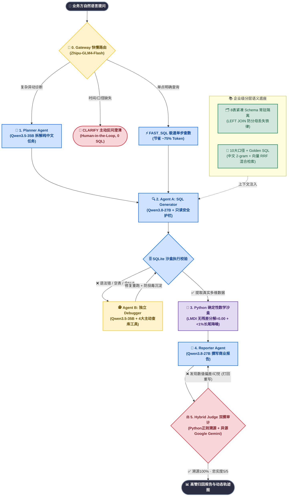

# BI Data Agent：基于异构多 Agent 协作的智能数据分析与归因系统

[](https://www.python.org/)
[](https://github.com/langchain-ai/langgraph)
[](https://www.trychroma.com/)
[-brightgreen.svg)]()
[]()

> 🚀 **[点击在线体验交互式工作台 Demo（零 API 消耗真实轨迹回放）](https://zhengjianhong-136.github.io/bi-data-agent/)**

> **项目定位**：针对传统 BI 取数链路长、常规 Text-to-SQL 在复杂业务语义下准确率低（公平基线仅 **33.3%**，Hard 题仅 **20.0%**）且缺乏严谨归因与幻觉治理的痛点，本项目基于 **LangGraph + 异构多模型路由 + 中文混合检索 RAG + 确定性 LMDI 沙盒 + 双模防幻觉审计（Hybrid Judge）** 构建企业级智能数据分析 Agent，并将 15 道分层业务评测集准确率从基线 **33.3%** 迭代提升至 **100.0%**。

---

##  一、 V1.0 → V1.5 量化迭代成果（15 题分层黄金评测集）

基于 Olist 真实电商 8 表数仓，构造涵盖 **Easy (L1) / Medium (L2) / Hard (L3)** 的 15 道高含金量业务口径评测题（覆盖有效 GMV、自然人 `customer_unique_id` 去重 UV、AOV/ASP 分母区分、履约延迟率、**一对多防扇出膨胀 Fan-out Trap**、周期复购率 CTE、历史首单老客归因、帕累托 Top3 集中度与跨月双门槛环比）：

| 难度等级 | 题目数 | 公平 Baseline<br>*(无口径RAG)* | V1.0<br>*(平权轮询 + 纯向量RAG)* | **V1.5 (Current)**<br>*(异构路由 + 中文混合RAG + Debugger)* | V1.5 平均执行次数 |
| :--- | :---: | :---: | :---: | :---: | :---: |
| **Easy (L1)** | 5 | 40.0% | 100.0% | **100.0%** | 1.0 |
| **Medium (L2)** | 5 | 40.0% | 80.0% | **100.0%** | 1.4 |
| **Hard (L3)** | 5 | 20.0% | 80.0% | **100.0%** | **1.0** |
| **Overall (总计)** | **15** | **33.3%** | **86.7%** *(1.47次)* | **100.0%** | **1.13** |

### V1.0 → V1.5 核心 Bad Case 归因与工程破局
* **破局 1（解决 Hard 题漏表报错）**：诊断发现 ChromaDB 默认英文向量模型（`all-MiniLM-L6-v2`）对中文词“英文商品品类”检索失效，导致 `category_translation` 被挤出 Top-9。V1.5 采用 **Schema 物理隔离常驻 + 中文 2-gram 与向量 RRF 混合重排**，Hard 题平均执行次数直接降至 **1.0 次（Pass@1 = 100%）**。
* **破局 2（消除弱模型方差与 100s 超时黑洞）**：淘汰平权轮询（避免轻量 Flash 模型随机撞上中难 SQL），重构为**基于角色的异构多模型路由器**并引入短超时熔断与体检预冷却。
* **破局 3（引入独立异构 Debugger Agent）**：Agent A 报错后移交高阶推理模型，配备 `list_all_tables / search_columns / peek_values / scan_all_kb` 四大只读主动探查工具破案重跑，并通过**防投毒静态口径门控**沉淀新经验。

---

## 二、 V1.5 全闭环系统架构



---

## 三、 异构多模型 FinOps 角色分工

摒弃“单一模型包打天下”与“无差别平权轮询”，按子 Agent 能力诉求匹配多厂商模型，并实现**跨厂商异源审计（消除同源模型自夸偏见）**：

| Agent 角色 | 逻辑分组 | 首选模型通道 | 核心设计考量 |
| :--- | :---: | :--- | :--- |
| **Gateway 意图网关** | `fast` | `Zhipu-GLM4-Flash` | `<1s` 极速响应、零成本拦截模糊提问与快慢分流 |
| **SQL Generator (Agent A)** | `coder` | `ModelScope-Qwen3.8-27B` | 中文语义理解与 SQLite 指令遵循极稳，禁止弱模型写复杂 SQL |
| **Planner & Debugger (Agent B)** | `reasoner` / `debugger` | `ModelScope-Qwen3.5-35B` | 仅在复杂拆解与 SQL 报错时按需触发，配备 4 大探查工具破案 |
| **Reporter 报告撰写** | `writer` | `ModelScope-Qwen3.8-27B` | 中文商业分析语感自然，严格基于 Python 确定性真值包成文 |
| **Hybrid Judge 幻觉审计** | `judge` | `Google-Gemini-3.5-Flash` | **跨厂商异源裁判**（Google 审阿里 Qwen），配合正则硬溯源杜绝幻觉 |

---

## 四、 仓库目录结构

```text
bi-data-agent/
├── README.md                                 # 项目总览、架构图与量化迭代报告
├── requirements.txt                          # Python 环境依赖清单
├── notebooks/
│   ├── 01_bi_attribution_agent_v1.ipynb      # V1.0 初始版本（保留演进基线）
│   └── 02_bi_agent_v1.5_hardened.ipynb       # V1.5 完整闭环加固版（异构路由/LMDI/Hybrid Judge）
├── docs/                                     # 独立解耦的 GitHub Pages 静态交互工作台
│   ├── index.html                            # 零构建前端界面 (Tailwind + ECharts)
│   ├── app.js                                # 轨迹步进重放与图表引擎
│   └── data/snapshots.js                     # 从 Kaggle 真实数仓导出的 4 场景轨迹快照
└── assets/                                   # 架构与图表静态资源
```

---

## 五、 迭代路线图 (Roadmap)

- [x] **v1.0.0**：8 表本地数仓、10 大核心业务口径、SQL 自纠错、4-Agent 异动归因流与 15 题分层评测集（准确率 `86.7%`）。
- [x] **v1.5.0 (Current)**：异构多模型 FinOps 路由、Schema 隔离 + 中文 RRF 混合检索、独立 Debugger 主动查库 Agent、确定性 LMDI 无残差分解、Gateway 三路网关、Hybrid Judge 跨厂商审计打回闭环（15 题准确率 **`100.0%`**，报告正则溯源 **`100.0%`**，忠实度 **`5/5`**）。
- [ ] **v2.0.0 (Planned)**：向泛化商业分析系统（AI Data Analyst）演进——引入多分析范式 Playbook（客户复购留存、RFM 价值分层、非结构化评论 NLP 情感归因）与持久化经验库。
