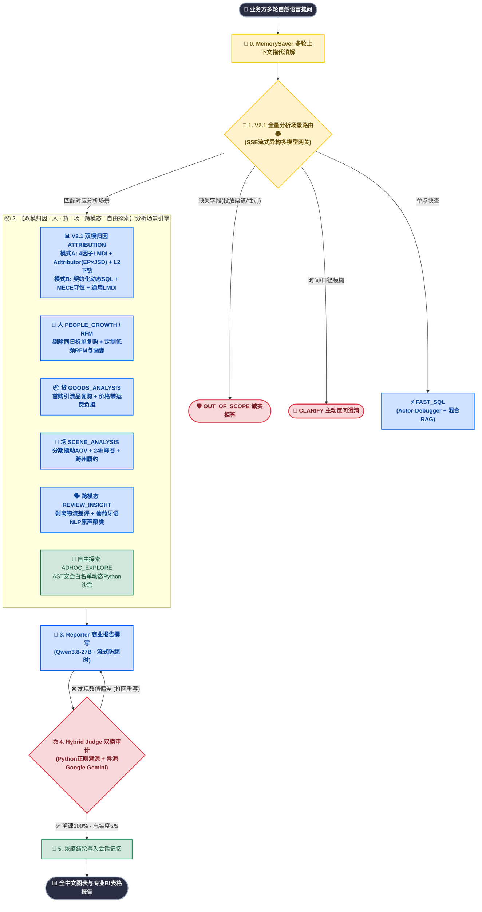

# 📊 BI Data Agent v2.1：双模智能归因 & 电商【人·货·场】泛化 AI 数据分析师

[](https://www.python.org/)
[](https://github.com/langchain-ai/langgraph)
[-brightgreen.svg)]()
[]()
[]()

> 🚀 **[点击在线体验 V2.1 交互式工作台 Demo（覆盖归因 + 人货场 + 跨模态评论 + 边界拒答等场景分析）](https://zhengjianhong-136.github.io/bi-data-agent/)**

> **项目定位**：从 V1.0 单一归因原型持续迭代至 **V2.1 通用 AI 数据分析师**。系统围绕电商 **【大盘双模归因 + 人 + 货 + 场 + 跨模态评论 + 自由探索】** 构建全量 **10 大分析场景**，核心攻克 **异构流式多模型 FinOps 路由、中文混合检索 RAG、独立 Debugger 主动查库、4 因子无残差 LMDI 与 Adtributor 自动下钻、契约化自定义维度 MECE 校验、AST 安全代码沙盒、多轮记忆下钻及跨厂商 Hybrid Judge 防幻觉审计**。

---

## 🏆 一、 双轨量化评测与迭代演进（V1.0 → V1.5 → V2.0 → V2.1）

### 1. 15 道分层业务口径 SQL 评测集 (Stratified SQL Benchmark)
覆盖有效 GMV、自然人 `customer_unique_id` 去重 UV、AOV/ASP 分母隔离、**一对多关联防扇出膨胀（Fan-out Trap）**、CTE 复购率、历史首单老客归因与帕累托集中度：

| 难度等级 | 题目数 | 公平 Baseline<br>*(无口径RAG)* | V1.0<br>*(平权轮询 + 纯向量RAG)* | **V1.5 ~ V2.1**<br>*(异构流式路由 + 中文混合RAG + Debugger)* | 平均执行次数 |
| :--- | :---: | :---: | :---: | :---: | :---: |
| **Easy (L1)** | 5 | 40.0% | 100.0% | **100.0%** | 1.0 |
| **Medium (L2)** | 5 | 40.0% | 80.0% | **100.0%** | 1.4 |
| **Hard (L3)** | 5 | 20.0% | 80.0% | **100.0%** | **1.0** |
| **Overall (总计)** | **15** | **33.3%** | **86.7%** *(1.47次)* | **100.0%** | **1.13** |

### 2. V2.0 / V2.1 泛化能力、双模归因与 FinOps 实测指标
* **10 类分析场景路由精准度**：**`100.0% (10/10)`**（覆盖超纲诚实拒答 `OUT_OF_SCOPE`、模糊澄清 `CLARIFY`、极速查数、大盘双模归因、人/货/场全套场景、跨模态评论 NLP 及 AST 自由探索）。
* **V2.1 双模智能归因引擎**：
  * **模式 A（开放式大盘自动分析）**：4 因子指标树 LMDI（GMV= UV * 频次 * 连带率 * 件单价）-> **Adtributor 6 维竞选（解释力 EP × 惊奇度 JS 散度）**->自动淘汰均匀波动伪维度 ->单切片贡献->自动触发 **Level 2 多跳交叉下钻**。
  * **模式 B（任意指定维度定向归因）**：8 大高频维度走语义注册表秒出；预设外任意自定义维度由 **Actor-Debugger 按 5 列标准契约动态写 SQL** ；**MECE 加和守恒校验 + 高基数长尾折叠 (`Others`)** ；通用确定性 LMDI 算子。
* **流式 FinOps 路由与零幻觉闭环**：底层采用 **SSE 流式接收拼接**彻底隔离死通道首字熔断（25s）与长报告生成耗时；跨厂商连续 **41 次调用 0 失败**（49% 轻量路由由免费 `Zhipu-GLM4-Flash` 承接）；报告经 **Python 正则硬溯源（`100.0%`）+ 跨厂商 Google Gemini 审计（`5/5`）** 零幻觉交付。

---

## 🏗️ 二、 V2.1 全闭环泛化架构



---

## 📂 三、 仓库目录与版本演进轨迹

```text
bi-data-agent/
├── README.md                                 # 项目全景说明、双轨评测与架构演进
├── requirements.txt                          # Python 环境依赖清单
├── notebooks/
│   ├── 01_bi_attribution_agent_v1.ipynb      # V1.0：初始原型 (8表数仓 + 3层RAG + 4-Agent归因)
│   ├── 02_bi_agent_v1.5_hardened.ipynb       # V1.5：工程加固 (异构路由 + 混合RAG + Debugger + Hybrid Judge)
│   └── 03_general_ai_data_analyst_v2.0.ipynb # V2.0：泛化版 (人货场10场景 + 跨模态NLP + AST沙盒 + 多轮记忆)
│   └── 03_general_ai_data_analyst_v2.1.ipynb # V2.1：完整泛化版 (双模归因 + 人货场10场景 + 跨模态NLP + AST沙盒 + 多轮记忆)
├── docs/                                     # 独立解耦的 GitHub Pages 零 API 交互工作台
│   ├── index.html                            # 零构建前端界面 (Tailwind + BI专业表格样式 + ECharts)
│   ├── app.js                                # V2.1 多图表引擎、数字自动右对齐与链路步进回放
│   └── data/snapshots.js                     # 从 Kaggle 真实数仓导出的 8 大分析场景快照
└── assets/                                   # 静态素材资源
```
