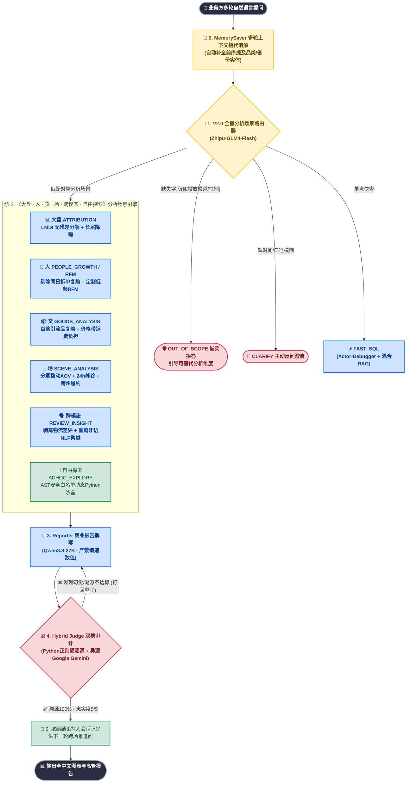

# 📊 BI Data Agent v2.0：基于异构多 Agent 的电商【人·货·场】泛化智能数据分析系统

[](https://www.python.org/)
[](https://github.com/langchain-ai/langgraph)
[-brightgreen.svg)]()
[]()
[]()

> 🚀 **[点击在线体验交互式工作台 Demo（覆盖人·货·场·跨模态评论·边界拒答 6 大真实轨迹回放）](https://zhengjianhong-136.github.io/bi-data-agent/)**

> **项目定位**：从 V1.0 单一异动归因原型一路演进至 **V2.0通用 AI 数据分析**。系统围绕经典电商 **【人、货、场】** 框架，整合 **异构多模型路由、中文混合检索 RAG、独立 Debugger 主动查库排障、6 大确定性 Python 业务算子、AST 安全动态代码沙盒、跨模态葡萄牙语评论 NLP 挖掘、LangGraph 多轮记忆下钻与跨厂商 Hybrid Judge 防幻觉审计**，实现 **15 题分层 SQL 评测 `100.0%`** 与 **10 大分析场景路由 `100.0%`** 双轨满贯。

---

## 🏆 一、 双轨自动化评测成果（V1.0 → V1.5 → V2.0 演进证据）

### 1. 轨迹一：15 道分层业务口径 SQL 评测集 (Stratified SQL Benchmark)
覆盖有效 GMV、自然人 `customer_unique_id` 去重 UV、AOV/ASP 分母隔离、**跨表一对多防扇出膨胀（Fan-out Trap）**、CTE 复购率、历史首单老客归因与帕累托 Top3 集中度：

| 难度等级 | 题目数 | 公平 Baseline<br>*(无口径RAG)* | V1.0<br>*(平权轮询 + 纯向量RAG)* | **V1.5 / V2.0**<br>*(异构路由 + 中文混合RAG + Debugger)* | 平均执行次数 |
| :--- | :---: | :---: | :---: | :---: | :---: |
| **Easy (L1)** | 5 | 40.0% | 100.0% | **100.0%** | 1.0 |
| **Medium (L2)** | 5 | 40.0% | 80.0% | **100.0%** | 1.4 |
| **Hard (L3)** | 5 | 20.0% | 80.0% | **100.0%** | **1.0** |
| **Overall (总计)** | **15** | **33.3%** | **86.7%** *(1.47次)* | **100.0%** | **1.13** |

### 2. 轨迹二：V2.0 全量 10 大分析场景路由评测集 & FinOps 稳定性验证
* **10 类分析场景路由精准度**：**`100.0% (10/10)`**（精准覆盖 `OUT_OF_SCOPE` 超纲诚实拒答、`CLARIFY` 模糊澄清、`FAST_SQL`、`ATTRIBUTION`、`PEOPLE_GROWTH`、`PEOPLE_RFM`、`GOODS_ANALYSIS`、`SCENE_ANALYSIS`、`REVIEW_INSIGHT`、`ADHOC_EXPLORE`）。
* **多轮追问下钻 & 审计表现**：基于 `MemorySaver` 跑通两轮跨分析场景指代消解下钻；深度报告实现 **LMDI 分解残差 `0.00`**、**Python 正则数值溯源 `100.0%`**、**跨厂商 Google Gemini 审计忠实度 `5/5`**。
* **FinOps 异构路由实测**：连续 **41 次跨厂商调用 `0` 失败**，约 **49% 的高频轻量路由与上下文改写请求（20/41 次）** 由轻量免费通道 `Zhipu-GLM4-Flash` 承接，把强推理额度精准留给 `Qwen35B` 与 `Gemini`。

---

## 🏗️ 二、 V2.0 【人·货·场】全闭环泛化架构



---

## 📂 三、 仓库目录与版本演进轨迹

```text
bi-data-agent/
├── README.md                                 # 项目全景说明、双轨评测与架构文档
├── requirements.txt                          # Python 环境依赖清单
├── notebooks/
│   ├── 01_bi_attribution_agent_v1.ipynb      # V1.0：初始原型 (8表数仓 + 3层RAG + 归因流)
│   ├── 02_bi_agent_v1.5_hardened.ipynb       # V1.5：工程加固 (异构路由 + 混合RAG + Debugger + LMDI + Hybrid Judge)
│   └── 03_general_ai_data_analyst_v2.ipynb   # V2.0：泛化平台 (人·货·场10场景 + 跨模态NLP + AST沙盒 + 多轮记忆)
├── docs/                                     # 独立解耦的 GitHub Pages 零 API 交互工作台
│   ├── index.html                            # 零构建静态界面 (Tailwind + ECharts)
│   ├── app.js                                # V2.0 多图表引擎与步进回放控制
│   └── data/snapshots.js                     # 从 Kaggle 真实数仓导出的 6 大分析场景快照
└── assets/                                   # 静态图表素材
```

---

## 🔀 四、 异构多模型 FinOps 角色分工

| Agent 角色 | 逻辑分组 | 首选主力通道 | 核心分工考量 |
| :--- | :---: | :--- | :--- |
| **多轮指代消解 & 场景路由** | `fast` | `Zhipu-GLM4-Flash` | 承接近 49% 高频轻量请求，`<1s` 响应且极大节省强模型配额 |
| **SQL 生成 & 动态沙盒代码** | `coder` | `ModelScope-Qwen3.8-27B` | 中文语义理解与 SQLite/Pandas 指令遵循极稳 |
| **深度规划 / 排障 / 评论NLP** | `reasoner` / `debugger` | `ModelScope-Qwen3.5-35B` | 按需低频触发，攻克复杂排障取证与葡萄牙语原声主题聚类 |
| **商业诊断报告撰写** | `writer` | `ModelScope-Qwen3.8-27B` | 中文商业分析语感自然，配合防 MathJax 崩坏清洗输出 |
| **防幻觉审计裁判** | `judge` | `Google-Gemini-3.5-Flash` | **跨厂商异源审计**（Google 审阿里 Qwen），彻底消除同源偏见 |
