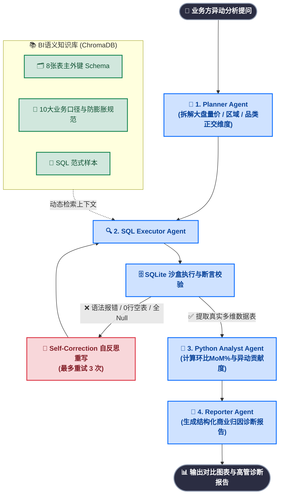
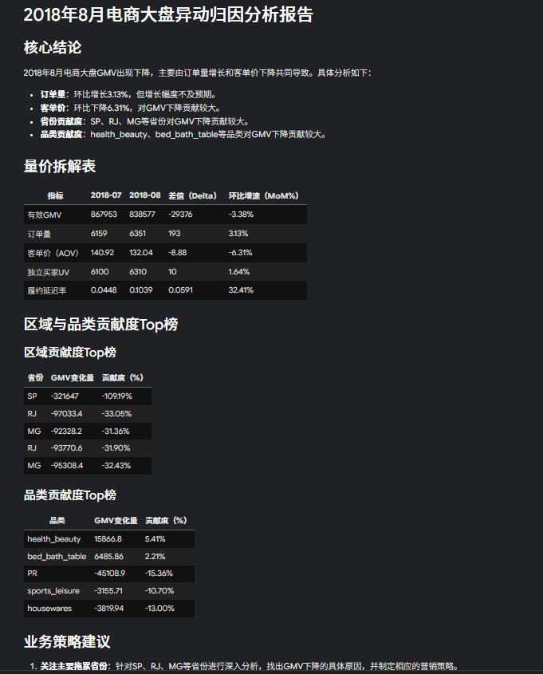

# BI Data Agent：基于多Agent协作的智能数据分析

[](https://www.python.org/)
[](https://github.com/langchain-ai/langgraph)
[](https://www.trychroma.com/)
[]()

> 🚀 **[点击这里在线体验交互式工作台Demo](https://zhengjianhong-136.github.io/bi-data-agent/)**

> **项目定位**：针对传统BI取数链路长、常规Text-to-SQL在复杂数仓语义下准确率低且只能“查数”不能“归因”的痛点，结合商业分析实战经验，基于**LangGraph + BI语义RAG + SQL 自纠错沙盒** 构建端到端智能归因分析Agent，并在 **15道分层评测集（Easy / Medium / Hard）** 上完成量化评估。

---

## 一、 解决的核心业务痛点

通常Text-to-SQL方案只注入建表语句（DDL），在真实电商/交易分析中极易踩坑。本项目在Olist真实电商8张关联表数仓上，重点攻克了以下 **4 类高频业务陷阱**：

1. **指标口径不对齐**：如“有效 GMV”需剔除 `canceled` 等未送达订单且不含运费；“订单取消率”分母需包含全量状态订单。
2. **业务实体粒度错位**：区分单次订单会话级 `customer_id` 与自然人唯一标识 `customer_unique_id`，解决 UV、周期复购率、历史新老客归因算错问题。
3. **一对多关联扇出膨胀**：当按支付方式（`order_payments`）筛选统计商品明细（`order_items`）GMV 时，防止直接 Join 导致金额翻倍虚高。
4. **语法方言与静默空结果**：拦截 SQLite 函数不兼容报错以及因过滤条件失误导致的 `0行空表` / `全Null` 结果，触发大模型自我反思重写。

---

## 二、 V1.0 系统架构流程

> 本项目当前为 **V1.0 版本**，核心实现 **BI语义知识库**、**带自纠错的Text-to-SQL引擎** 与 **四角色LangGraph归因工作流**。


---

## 三、 分层评测结果 (Stratified Benchmark)

本项目基于Olist数据集构建了包含 **Easy/Medium/Hard** 三个难度等级的 **15道标准评测题**，对比 **Baseline（仅提供基础表字段、无业务字典 RAG）** 与 **本系统 Agent（语义 RAG + 自纠错）** 的执行结果一致率（Execution Accuracy）：
> 由于该项目运行时调用多个大模型接口，可能会有重跑时出现不一致的情况，个人曾跑过Hard模式下100%准确率，猜测是模型能力导致。

| 难度 | 题目数 | Baseline准确率 | Agent准确率 | 平均执行次数 |
| :--- | :---: | :---: | :---: | :---: |
| Easy | 5 | 0.0% | 100.0% | 1.0 |
| Medium | 5 | 0.0% | 80.0% | 1.4 |
| Hard | 5 | 0.0% | 60.0% | 1.8 |
| **Overall (总计)** | **15** | **0.0%** | **80.0%** | **1.4** |

---

## 四、 实战效果预览（2018-07 vs 2018-08 异动归因）

系统自动完成大盘量价、省份及品类多维数据探查后，生成诊断分析报告：



*(完整多 Agent 运行日志、SQL 自纠错过程及 15 道评测逐题明细请直接点击查看 `notebooks/01_bi_attribution_agent_v1.ipynb`)*

---

## 五、 如何运行本项目

1. **数据准备**：从 Kaggle 下载 `Brazilian E-Commerce Public Dataset by Olist`（或在 Kaggle 新建 Notebook 直接挂载该数据集）。
2. **环境配置**：
   ```bash
   pip install -r requirements.txt
   ```
3. **密钥配置**：在 Kaggle Secrets（或本地环境变量）中配置 `LLM_API_KEY`（兼容 DeepSeek / 通义千问等 OpenAI 格式接口）。
4. **运行顺序**：按顺序执行 `notebooks/01_bi_attribution_agent_v1.ipynb` 中的各个Cell。

---

## 六、 迭代路线图 (Roadmap)

本项目采用敏捷迭代方式持续演进：
- [x] **v1.0 (Current)**：构建 8 表本地数仓、10 大核心口径语义层、SQL 自纠错引擎、4-Agent 异动归因流与 15 题分层评测集。
- [ ] **v1.5 (Next)**：引入确定性数学沙盒（**LMDI 对数平均迪氏无残差分解** + 长尾噪音降噪）、**快慢思考路由网关（Gateway Router）**、以及 **Hybrid Judge（正则硬溯源 + LLM-as-a-Judge 审计打回重写闭环）**。
- [ ] **v2.0 (Future)**：升级为泛化智能商业分析系统，扩展 **分析方法论 Playbook 库**（例如客户复购与留存分析、RFM 分层、趋势诊断）与动态 Python Code Interpreter 沙盒。
